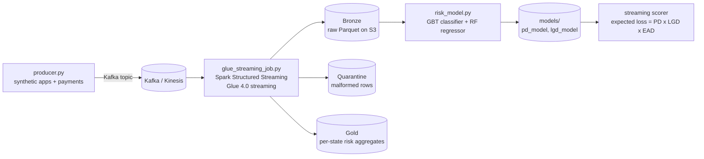

# Mortgage Risk ML

Mortgage default and loss modeling on a real-time streaming pipeline, built with Python and PySpark. Synthetic mortgage applications and payment events flow through Kafka into a Spark Structured Streaming job (designed for AWS Glue streaming), landing in bronze/silver/gold layers on S3. A complex ML model then predicts **probability of default (PD)** and **loss given default (LGD)**, combined into an expected-loss score per loan.

> **Disclaimer:** everything here is simulated and educational. It is not financial advice, not a lending decision tool, and must not be used on real borrower data.

## Architecture



## Tech stack

- Python 3.10, PySpark 3.5 (Structured Streaming + MLlib)
- Kafka (local dev) / Amazon Kinesis (Glue production)
- AWS Glue 4.0 streaming jobs, S3 data lake, CloudWatch metrics
- MLlib: Gradient-Boosted Trees (PD), Random Forest (LGD)

## Project structure

```
mortgage-risk-ml/
├── src/
│   ├── config.py            # env-var driven settings (no hardcoded secrets)
│   ├── producer.py          # synthetic mortgage event generator -> Kafka
│   ├── glue_streaming_job.py# streaming ETL: bronze/silver/gold, quarantine
│   └── risk_model.py        # PD + LGD training, expected-loss scoring
├── notebooks/
│   └── mortgage_analysis.ipynb
├── requirements.txt
└── docker-compose.yml       # local Kafka for development
```

## Quickstart

```bash
# 1. Install and start local Kafka
pip install -r requirements.txt
docker compose up -d

# 2. Produce synthetic events
python -m src.producer --rate 5 --duration 300

# 3. Run the streaming job locally (Glue parity mode)
spark-submit --packages org.apache.spark:spark-sql-kafka-0-10_2.12:3.5.1 \
    src/glue_streaming_job.py kafka

# 4. Train the risk models on the silver layer
python -m src.risk_model
```

On AWS Glue, create a streaming job with `src/glue_streaming_job.py`, set the job
parameters (`--KINESIS_STREAM`, `--RAW_BUCKET`, `--GLUE_IAM_ROLE`), and attach the
Glue service IAM role. The `--source kinesis` argument switches the reader.

## Model

- **PD (probability of default):** GBT classifier, 80 trees, depth 5, predicting 90+ day delinquency within 24 months. Sample-weighting handles the ~5% default rate.
- **LGD (loss given default):** Random Forest regressor (120 trees) on defaulted loans only, predicting loss fraction of the outstanding balance.
- **Expected loss:** `EL = PD x LGD x EAD`, scored per application for portfolio triage.

Example metrics on synthetic data: PD AUC ~0.78, LGD RMSE ~0.11. Your mileage will vary - these numbers describe the demo data, not real lending.

## Data model

| Field | Type | Description |
|---|---|---|
| application_id | string | synthetic loan key |
| credit_score | int | 580-840 |
| loan_to_value | float | 0.55-0.98 |
| debt_to_income | float | 0.15-0.55 |
| payment_status | string | on_time / late / missed |

## Future work

- Add macroeconomic features (rate curves, unemployment) to the PD model
- Fairness auditing across protected attributes before any real-world use
- Glue job bookmarks + schema evolution for the silver layer
- Real-time scoring sink back to Kafka for downstream servicing systems
